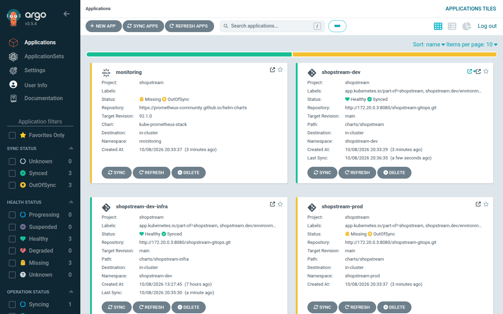
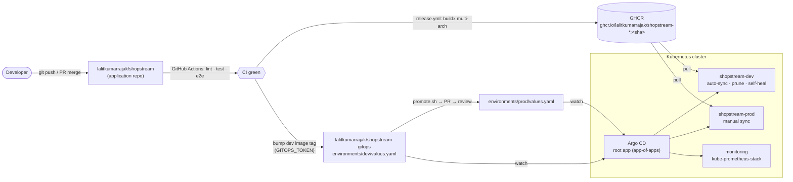
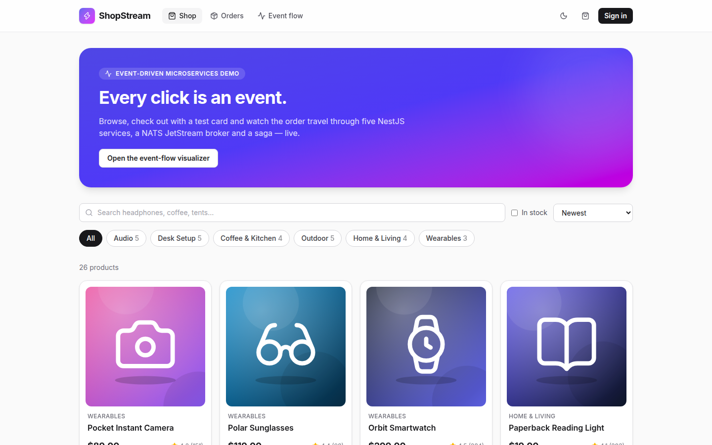
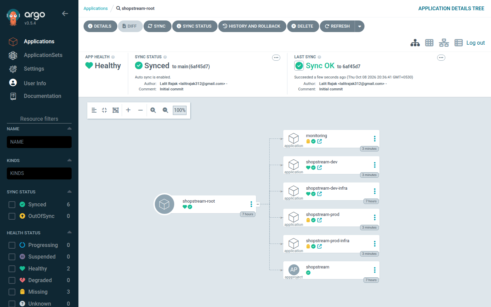
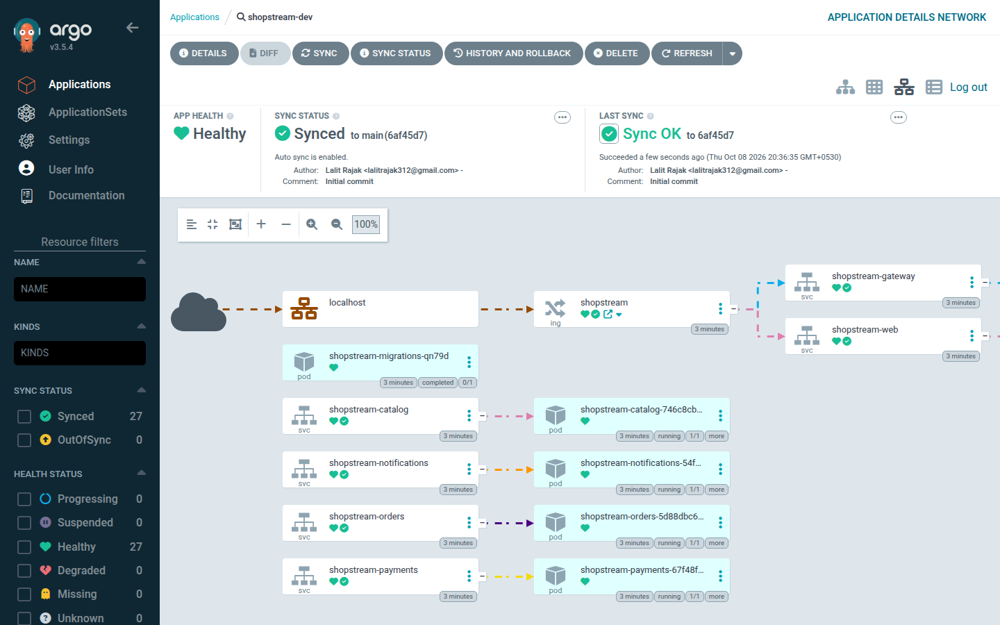

# shopstream-gitops

**GitOps delivery for [ShopStream](https://github.com/lalitkumarrajak/shopstream)** — the event-driven
e-commerce microservices system (NestJS · Apollo Federation · MongoDB · PostgreSQL · NATS JetStream).
Helm charts with a shared library chart, Argo CD app-of-apps with `dev` (auto-sync, self-heal) and
`prod` (manual, promoted by PR) environments, default-deny NetworkPolicies, restricted Pod Security,
Prometheus/Grafana observability, a **one-command kind bootstrap**, and a Terraform module for a k3s
cluster on **Hetzner Cloud**.

```bash
scripts/bootstrap-kind.sh   # kind + ingress-nginx + Argo CD + ShopStream  ->  http://localhost:4780
```



## Contents

- [GitOps flow](#gitops-flow)
- [Repository layout](#repository-layout)
- [Run it on kind (one command)](#run-it-on-kind-one-command)
- [Helm charts](#helm-charts)
- [Argo CD](#argo-cd)
- [Environments and promotion](#environments-and-promotion)
- [Secrets](#secrets)
- [Security hardening checklist](#security-hardening-checklist)
- [Observability](#observability)
- [Hetzner Cloud (k3s via Terraform)](#hetzner-cloud-k3s-via-terraform)
- [CI](#ci)
- [Design decisions](#design-decisions)
- [Known limitations](#known-limitations)

## GitOps flow



1. A push to `main` in the application repo builds and pushes images tagged with the commit SHA
   (and `latest`) to GHCR.
2. If the `GITOPS_TOKEN` secret is configured there, the release workflow commits the new SHA to
   `environments/dev/values.yaml` **in this repo**; Argo CD notices and rolls dev forward automatically
   (PreSync migration Job first).
3. Promotion to prod is a pull request (`scripts/promote.sh <sha>`) that changes only the prod image tag;
   after review and merge someone presses **Sync** on `shopstream-prod` in Argo CD.

Git is the only source of truth: nobody runs `kubectl apply` against the environments, and drift in dev is
reverted automatically (self-heal).

## Repository layout

```
argocd/
  root-app.yaml                 the only manifest applied by hand (app-of-apps root)
  apps/                         Helm chart rendering the AppProject + per-environment Applications
  bootstrap/argocd-cm-patch.yaml  Application health check so sync waves wait for child apps
  notifications/                Argo CD Notifications example (Slack templates & triggers)
charts/
  shopstream-lib/               library chart: names/labels, hardened Deployment+Service+SA, HPA, PDB,
                                NetworkPolicy and ServiceMonitor templates shared by both charts
  shopstream/                   application umbrella chart (gateway, 4 subgraphs, web, migrations Job,
                                ingress, default-deny + per-service NetworkPolicies, alerts, dashboard)
  shopstream-infra/             MongoDB replica set, PostgreSQL, NATS JetStream StatefulSets + the
                                app Secret (plain for dev, ExternalSecret or SealedSecret for prod)
environments/
  dev/values.yaml, dev/infra-values.yaml
  prod/values.yaml, prod/infra-values.yaml, prod/sealed-secret.example.yaml
observability/
  kube-prometheus-stack-values.yaml
  dashboards/ -> charts/shopstream/dashboards (Grafana RED dashboard JSON)
infra/terraform/hetzner/        k3s on Hetzner Cloud (network, firewall, placement group, LB)
scripts/
  bootstrap-kind.sh             one-command local environment (used by CI too)
  build-images.sh               builds images from the app repo when GHCR has none yet
  local-git-server.sh           serves this checkout to Argo CD over git smart-HTTP (no push needed)
  smoke-test.mjs                checkout happy path + saga compensation through the ingress
  validate.sh                   helm lint + template + kubeconform + kube-score (same as CI)
  checkov.sh                    Checkov policy scan of rendered prod manifests + Terraform
  promote.sh                    dev → prod promotion PR
```

## Run it on kind (one command)

> Verified end to end on a laptop: cluster up, Argo CD syncs dev from Git, NetworkPolicies enforced
> (e.g. web → MongoDB and gateway → PostgreSQL are blocked), and the smoke test passes through the ingress.

Prerequisites: Docker (≈4 GB free RAM), `kind`, `kubectl`, `git`, Node.js ≥ 20 (for the smoke test).
Helm is only needed for `scripts/validate.sh`.

```bash
git clone https://github.com/lalitkumarrajak/shopstream-gitops && cd shopstream-gitops
scripts/bootstrap-kind.sh
```

What it does:

1. creates a single-node kind cluster (`scripts/kind-config.yaml`, Kubernetes 1.37) with the node's
   port 80 published on **localhost:4780**;
2. installs ingress-nginx;
3. makes the ShopStream images available: reuses local images, else pulls
   `ghcr.io/lalitkumarrajak/shopstream-*:<dev tag>`, else **builds them from the application repo**
   (`SHOPSTREAM_SRC`, default `../shopstream`, cloned if missing) and `kind load`s them — so it works
   before anything is published;
4. installs Argo CD and patches it (Application health check, 30 s reconciliation);
5. starts a tiny git smart-HTTP server on the kind network that serves **this checkout's committed
   HEAD**, and applies `argocd/root-app.yaml` pointing at it (`GITOPS_SOURCE=github` uses GitHub instead);
6. waits for Argo CD to sync `shopstream-dev-infra` (wave −1) and `shopstream-dev` (wave 0, with the
   PreSync `prisma migrate deploy` Job), then
7. runs `scripts/smoke-test.mjs` through the ingress: a 4242 checkout must reach **CONFIRMED** and a
   declined card must be **CANCELLED** with stock released (saga compensation).

| URL                                                                                  | What                                                 |
| ------------------------------------------------------------------------------------ | ---------------------------------------------------- |
| http://localhost:4780                                                                | Storefront (`demo@shopstream.dev` / `demo-password`) |
| http://localhost:4780/flow                                                           | Live event-flow visualizer                           |
| http://localhost:4780/graphql                                                        | Federated GraphQL API                                |
| `kubectl -n argocd port-forward svc/argocd-server 4781:443` → https://localhost:4781 | Argo CD UI (`admin`, password printed by the script) |

Tear down: `kind delete cluster --name shopstream && docker rm -f shopstream-gitops-git`.

> The prod Applications are created too but stay **OutOfSync** — prod is manual by design (and its
> `unreleased` image tag would not exist yet). The `monitoring` Application is manual as well; sync it
> from the Argo CD UI if your machine has the extra ~1.5 GB of RAM for Prometheus and Grafana.



## Helm charts

**`shopstream-lib`** (library) renders a complete hardened workload from a few values: ServiceAccount
(token automount off), Deployment (rolling update with `maxUnavailable: 0`, topology spread, startup /
liveness `/health` / readiness `/ready` probes, restricted security contexts, read-only root FS with a
size-limited `/tmp`), Service, optional HPA (`autoscaling/v2`, CPU and memory), PDB and ServiceMonitor,
plus a NetworkPolicy helper that always allows DNS and nothing else unless listed.

**`shopstream`** (application):

| Workload       | Port | Notes                                                                                                  |
| -------------- | ---- | ------------------------------------------------------------------------------------------------------ |
| gateway        | 4000 | Apollo Federation gateway; only workload reachable from the ingress controller (besides web)           |
| catalog        | 4001 | MongoDB, NATS                                                                                          |
| orders         | 4002 | PostgreSQL, NATS; schema migrated by the PreSync Job                                                   |
| payments       | 4003 | MongoDB, NATS                                                                                          |
| notifications  | 4004 | MongoDB, NATS; Server-Sent Events via the gateway                                                      |
| web            | 3000 | Next.js standalone server; no egress at all                                                            |
| migrations Job | —    | `prisma migrate deploy`, waits for PostgreSQL, Argo CD `PreSync` hook / Helm `pre-install,pre-upgrade` |

The Ingress routes `/graphql` and `/events` to the gateway and everything else to the web app, disables
proxy buffering and raises timeouts for SSE, rate-limits per client, and carries the
`cert-manager.io/cluster-issuer` annotation + TLS block when `ingress.tls.enabled` (prod).

**`shopstream-infra`** — why simple StatefulSets instead of Bitnami/operator charts: they work fully
offline in kind, start in seconds within a few hundred MB, are small enough to read in one sitting, and
avoid the Bitnami catalogue changes (images moved behind a subscription in 2025). They are still
production-shaped (PVCs, probes, non-root, read-only root FS, NetworkPolicies) — MongoDB runs as a
single-member **replica set** initialised by a native sidecar so multi-document transactions work; NATS
runs JetStream with file storage. In prod, MongoDB and PostgreSQL are **disabled** in favour of managed
services (Atlas, Neon/RDS) and the recommendation is the official `nats-io/nats` chart for a clustered
JetStream (R3) or operators such as CloudNativePG / MongoDB Community Operator.

## Argo CD

- **App-of-apps:** `argocd/root-app.yaml` → `argocd/apps` (a Helm chart) renders the `shopstream`
  **AppProject** (allowed repos, namespaces and cluster-scoped kinds; read-only and deployer roles) and,
  per environment, an **infra** Application (sync-wave −1) and an **app** Application (wave 0). Rendering
  the children with Helm lets the bootstrap point every Application at a different repo URL/revision with
  one value — which is how the local git server and CI work.
- **Sync waves & hooks:** databases/broker/secret (wave −1) must be Healthy before the app (wave 0).
  Argo CD ≥ 1.8 no longer assesses Application health by default, so `argocd/bootstrap/argocd-cm-patch.yaml`
  restores the health check that makes waves wait. Inside the app, the migrations Job is a `PreSync` hook
  with `BeforeHookCreation` delete policy; manual environments sit in wave 10 so they never block the root.
- **Sync policies:** dev = `automated` with `prune` + `selfHeal`; prod = manual. Both use
  `CreateNamespace`, `ServerSideApply`, `PruneLast`, retries with backoff, `managedNamespaceMetadata`
  (Pod Security Admission `restricted` labels) and ignore `/spec/replicas` (owned by the HPA).
- **Notifications:** `argocd/notifications/argocd-notifications-cm.yaml` defines Slack templates and
  triggers (sync succeeded/failed, health degraded); prod Applications subscribe via annotations.





## Environments and promotion

|            | dev (`shopstream-dev`)                    | prod (`shopstream-prod`)                             |
| ---------- | ----------------------------------------- | ---------------------------------------------------- |
| Sync       | automatic, prune, self-heal               | manual after PR review                               |
| Image tag  | bumped by the app repo's release workflow | promoted SHA (`scripts/promote.sh`)                  |
| Replicas   | 1, no HPA/PDB                             | HPA (gateway 3–10, others 2–4), PDBs                 |
| Databases  | in-cluster MongoDB + PostgreSQL           | managed (Atlas / Neon / RDS), egress allowed by CIDR |
| NATS       | in-cluster                                | in-cluster, 10 Gi `hcloud-volumes`                   |
| Secrets    | plain dev-only Secret from values         | External Secrets Operator (or Sealed Secrets)        |
| TLS        | off (localhost)                           | cert-manager `letsencrypt-prod`                      |
| Monitoring | —                                         | ServiceMonitors, PrometheusRule, Grafana dashboard   |
| Tracing    | —                                         | OTLP → collector in `observability`                  |

Promotion is deliberately boring: `scripts/promote.sh <sha>` edits one line in
`environments/prod/values.yaml`, opens a PR, and the diff Argo CD shows for `shopstream-prod` is exactly
the image change. Rollback = revert the commit.

## Secrets

No real secret is committed. The application reads `JWT_SECRET`, `DATABASE_URL`, `DIRECT_URL` and
`MONGODB_URI` from one Secret, `shopstream-secrets`, owned by the **infra** chart so it exists before the
migration hook runs. Three modes:

1. **dev:** rendered from `environments/dev/infra-values.yaml` with obviously fake values, for a
   throwaway kind cluster only.
2. **prod (default): External Secrets Operator** — an `ExternalSecret` pulls the keys from a
   `ClusterSecretStore` (Vault, AWS/GCP secret managers, 1Password, …). Rotation is a change in the
   backend; nothing in Git changes.
3. **Sealed Secrets** — `environments/prod/sealed-secret.example.yaml` shows the `kubeseal` workflow;
   only ciphertext that just the in-cluster controller can decrypt is committed.

## Security hardening checklist

- [x] Pod Security Admission **`restricted`** enforced on the namespaces (via `managedNamespaceMetadata`)
- [x] `runAsNonRoot`, high UIDs (10001) for app pods, `seccompProfile: RuntimeDefault`
- [x] `readOnlyRootFilesystem: true`, `allowPrivilegeEscalation: false`, **all capabilities dropped**
- [x] No service-account tokens mounted (`automountServiceAccountToken: false`), one SA per workload
- [x] **Default-deny NetworkPolicy** + explicit allows: ingress-nginx → gateway/web only; gateway →
      subgraphs; subgraphs → NATS + their own database; web → nothing; migrations → PostgreSQL;
      monitoring → metrics ports; DNS for all
- [x] Resource requests and limits on every container; size-limited `emptyDir`s
- [x] Startup, liveness (`/health`) and readiness (`/ready`, checks DB + broker) probes
- [x] PodDisruptionBudgets + HPAs + topology spread in prod; `maxUnavailable: 0` rollouts
- [x] Immutable image tags (git SHA) in prod; images are multi-stage, non-root, minimal
- [x] Secrets never in Git (External Secrets / Sealed Secrets), dev placeholders clearly marked
- [x] TLS via cert-manager; HTTP → HTTPS redirect; request rate limiting at the ingress
- [x] Least-privilege Argo CD AppProject (allowed repos, destinations and cluster-scoped kinds; RBAC roles)
- [x] Policy gates in CI: kubeconform (schemas incl. CRDs), kube-score, Checkov
- [x] Hetzner: SSH/API restricted by firewall CIDRs, k3s secrets encryption, PSA defaults, nodes behind a
      private network with the LB using private IPs

Deliberate exceptions (documented in `scripts/validate.sh` / `scripts/checkov.sh`): tags instead of
digests, `IfNotPresent` pull policy (immutable tags), burstable CPU, connection strings as env vars from a
Secret, and the official MongoDB/PostgreSQL images' built-in UIDs (999/70).

## Observability

- Every service exposes Prometheus metrics on `/metrics` (RED histogram
  `http_server_request_duration_seconds`, `shopstream_events_consumed_total{outcome}`
  (processed/duplicate/retried/dead_lettered), handler latency, published events, outbox backlog, Node.js
  runtime) — scraped through **ServiceMonitors** rendered by the library chart.
- **`observability/kube-prometheus-stack-values.yaml`** — deployed by the `monitoring` Application;
  selects ServiceMonitors/rules cluster-wide and loads dashboards from labelled ConfigMaps.
- **Grafana dashboard** (`observability/dashboards/shopstream-red.json`, shipped as a ConfigMap): request
  rate, error ratio, p50/p95/p99 latency per service, events by outcome, publish rate, handler latency,
  outbox backlog, memory and event-loop lag.
- **Alerts** (`PrometheusRule`): high 5xx ratio, high p95 latency, dead-lettered events, retry storms,
  outbox backlog (broker unreachable), pods not ready, missing replicas — plus recording rules.
- Traces: services export OTLP (W3C trace context propagated through NATS headers) to the collector
  configured by `OTEL_EXPORTER_OTLP_ENDPOINT`.

## Hetzner Cloud (k3s via Terraform)

`infra/terraform/hetzner` provisions a small production-shaped k3s cluster: private network + subnet,
firewall (SSH and API only from your CIDRs), spread placement group, one k3s server (tainted, secrets
encryption, Traefik/ServiceLB disabled, Pod Security defaults) and N agents joining over the private
network, plus an `lb11` load balancer forwarding 80/443 to the ingress-nginx NodePorts over private IPs.

```bash
cd infra/terraform/hetzner
export TF_VAR_hcloud_token=…                       # never commit it
cp terraform.tfvars.example terraform.tfvars        # set your SSH key and CIDRs
terraform init && terraform plan && terraform apply
$(terraform output -raw kubeconfig_command) && export KUBECONFIG=$PWD/kubeconfig-shopstream.yaml

# then, on the new cluster:
helm upgrade --install ingress-nginx ingress-nginx --repo https://kubernetes.github.io/ingress-nginx \
  -n ingress-nginx --create-namespace --set controller.service.type=NodePort \
  --set controller.service.nodePorts.http=30080 --set controller.service.nodePorts.https=30443
# + cert-manager, External Secrets Operator and the hcloud CSI driver (StorageClass hcloud-volumes)
kubectl create namespace argocd
kubectl apply -n argocd --server-side -f https://raw.githubusercontent.com/argoproj/argo-cd/v3.5.4/manifests/install.yaml
kubectl -n argocd patch cm argocd-cm --type merge --patch-file argocd/bootstrap/argocd-cm-patch.yaml
kubectl apply -n argocd -f argocd/root-app.yaml
```

Point the DNS record of your prod host at `terraform output ingress_load_balancer_ipv4`. For ShopStream's
Asia-hosted demo data (Atlas Mumbai, Neon Singapore) choose `location = "sin"` / `network_zone =
"ap-southeast"`.

`terraform fmt -check` and `terraform validate` run in CI; **nothing has been applied** from this repo.

## CI

`.github/workflows/ci.yml`:

| Job       | What                                                                                                                                                                                                                                                                 |
| --------- | -------------------------------------------------------------------------------------------------------------------------------------------------------------------------------------------------------------------------------------------------------------------- |
| manifests | `scripts/validate.sh`: `helm lint` (all charts, both environments), `helm template`, **kubeconform** (strict, Kubernetes + CRD catalog schemas for Argo CD, Prometheus Operator, External Secrets, Sealed Secrets), **kube-score**                                   |
| checkov   | `scripts/checkov.sh`: Checkov on rendered prod manifests and the Terraform module                                                                                                                                                                                    |
| terraform | `terraform fmt -check`, `init -backend=false`, `validate`                                                                                                                                                                                                            |
| kind-e2e  | checks out the app repo, **builds the images**, runs `scripts/bootstrap-kind.sh` (kind → ingress-nginx → Argo CD → app-of-apps synced from this exact commit via the in-network git server) and the **smoke test through the ingress**; dumps diagnostics on failure |

## Design decisions

- **Umbrella chart + library chart** rather than one chart per service: the five backends are
  identical in shape, so a library keeps the hardening in one place while values stay per service; one
  release per environment makes the PreSync migration and NetworkPolicies coherent.
- **Infra as a separate Application** so it can be swapped for managed services per environment and so
  sync waves can order "databases and secrets first".
- **Helm-rendered app-of-apps** instead of an ApplicationSet: identical result for two environments,
  but trivially overridable (repo URL / revision) for local and CI runs, and lintable with the same tooling.
- **ingress-nginx** for the kind setup because it is the de-facto local standard and SSE-friendly. Note
  that the upstream project was retired in March 2026; for a new production cluster prefer a Gateway API
  implementation (e.g. Envoy Gateway or NGINX Gateway Fabric) — only `templates/ingress.yaml` would change.

## Known limitations

- Single-replica MongoDB/PostgreSQL/NATS in-cluster (dev); prod expects managed databases.
- Prod values reference placeholders (`shop.example.com`, a `vault-backend` ClusterSecretStore, an OTLP
  collector) that must exist in the target cluster.
- The local git server serves committed HEAD only — commit before re-running the bootstrap.

## License

[MIT](LICENSE) © Lalit Rajak
